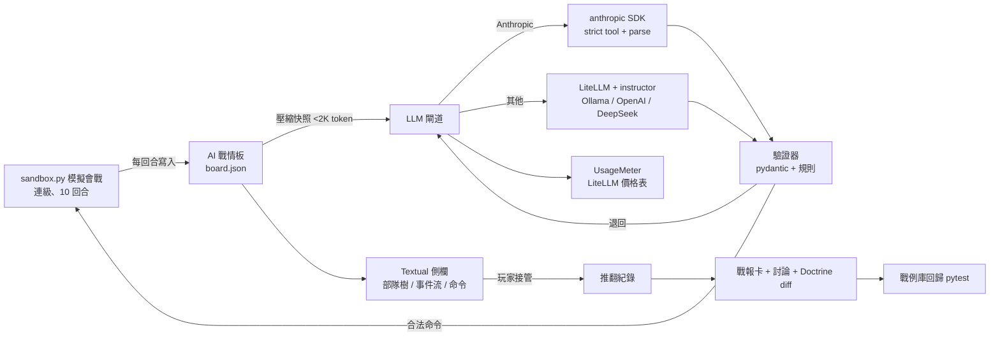

# 08 Stage 2：架構設計與環境建置（M0）

> 文件狀態：🟡 進行中（2026-11-01）｜對應心智圖節點：`5. 技術架構 → M0 技術棧`、`6. 里程碑 → M0`
> 研究方式：deer-flow 不可用，WebSearch 降級＋**實際在沙盒用 uv 安裝驗證**（版本、相容性、授權都是裝出來的，不是查出來的）。

## 1. 候選技術盤點與比價結論

| 用途 | 候選 | 選定 | 理由（含來源） |
|---|---|---|---|
| Python 與套件管理 | uv ／ pip+venv ／ Poetry | **uv** | uv 同時管 Python 版本與套件，新手少裝一樣東西；多篇 2026 比較都把它列為新專案預設（[DEV](https://dev.to/truongandev/uv-vs-poetry-vs-pip-in-2026-which-one-wins-458l)、[itsourcecode](https://itsourcecode.com/blogs/uv-vs-pip-vs-poetry-2026/)）。沙盒實測：83 個套件 3 秒解析完成。放棄 pip+venv：沒有 lockfile；放棄 Poetry：較慢且多學一套指令 |
| 終端機戰情板 | Textual ／ Rich ／ curses | **Textual 8.2.8**（Rich 隨附） | curses 在 Windows 原生不可用（[Real Python](https://realpython.com/ref/stdlib/curses)）；Rich 沒有輸入與事件處理；Textual 有 Tree／DataTable 元件、文件 2026-07 仍在更新（[pistack 比較](https://www.pistack.xyz/posts/2026-07-01-python-terminal-ui-libraries-textual-rich-prompt-toolkit-urwid/)）。MIT |
| OpenAI 相容閘道 | LiteLLM ／ 自寫 httpx ／ 各家官方 SDK | **LiteLLM 1.106.6** | 一次接 100+ 家、統一 usage、自帶價格表（F13 直接受益）（[LiteLLM 成本追蹤](https://dev.to/binyam/cost-tracking-and-model-spend-monitoring-with-litellm-4io2)）。放棄自寫：每家 usage 格式不同，重造輪子。MIT |
| Anthropic 路徑 | 走 LiteLLM ／ 官方 SDK | **官方 anthropic 2.3.0** | 要用 strict tool、`messages.parse()` 結構化輸出、prompt caching、串流，官方 SDK 最快跟上（依 claude-api skill 2026-10 版）。Apache-2.0 |
| 結構化輸出與重試 | instructor ／ pydantic-ai ／ 自寫 | **instructor 1.17.0**（LiteLLM 路徑）＋ **anthropic SDK `messages.parse()`**（Anthropic 路徑） | instructor 是薄層、會把驗證錯誤回饋給模型重試（[比較](https://www.developersdigest.tech/compare/pydantic-ai-vs-instructor)）；pydantic-ai 是整套 agent 框架，對 M0 過重。MIT |
| 資料模型 | pydantic 2.14.2 | ✅ | 兩條路徑共用同一份 `issue_orders` schema |
| 本地模型 | Ollama | ✅（ADR-0009） | 建議先拉小模型測流程（⚠️ 模型名稱以 ollama.com/library 為準） |
| 測試 | pytest 9.2.0 | ✅ | 戰例庫回歸直接用 |

**沙盒實測結果（2026-11-01）**：`uv lock` 解析 83 個套件無衝突，`uv sync` 安裝成功，`import textual, litellm, instructor, anthropic, pydantic` 全部通過。鎖定檔在 `m0/uv.lock`。

## 2. M0 邏輯流程圖

## 3. 環境建置精靈：導覽（老闆說「開始」才逐步走）

| 步驟 | 會拿到什麼 | 預估 | macOS | Windows |
|---|---|---|---|---|
| 1 | uv（含 Python 3.12+） | 5 分 | 終端機一行安裝指令 | PowerShell 一行安裝指令 |
| 2 | Git 與專案資料夾 | 5 分 | 多半已內建 | 安裝 Git for Windows |
| 3 | Ollama 與一個小模型 | 10 分（下載約 2 GB） | 官網下載安裝 | 同左 |
| 4 | Anthropic API 金鑰 | 5 分 | 在 Anthropic Console 建立（⚠️ 後台路徑需老闆截圖確認） | 同左 |
| 5 | 金鑰寫入 `.env`（不經聊天） | 2 分 | `bash tools/capture_keys.sh` | `powershell -File tools\capture_keys.ps1` |
| 6 | 套件安裝與體檢通過 | 3 分 | `uv sync` → `uv run python -m chief.doctor` | 同左 |
| 7 | 實體護欄 | 0 分 | ✅ 已由 Claude 裝好並自測 | 同左 |

總計約 30 分鐘，其中 Ollama 模型下載看網速。每一步我會給準確網址、說明預期畫面，等老闆回「好了」再給下一步。

### 金鑰與環境變數三欄表（完工判準）

| 變數 | ① 從哪拿 | ② 寫到哪 | ③ 機密？ |
|---|---|---|---|
| `ANTHROPIC_API_KEY` | Anthropic Console → API Keys（⚠️ 路徑未驗證，請老闆截圖） | `m0/.env`（捕捉腳本寫入，`.gitignore` 已排除） | 機密 |
| `OPENAI_API_KEY` | OpenAI 平台（選用，M0 不必） | 同上 | 機密 |
| `DEEPSEEK_API_KEY` | DeepSeek 平台（選用，對決時才要） | 同上 | 機密 |
| `OLLAMA_HOST` | 預設 `http://localhost:11434` | `m0/.env`（可直接用 `.env.example` 的值） | 公開 |
| `OLLAMA_MODEL` | 老闆選的小模型名稱 | 同上 | 公開 |

### 故障排除表

| 看到 | 通常是因為 | 怎麼辦 |
|---|---|---|
| `uv: command not found` / 不是內部命令 | 安裝後沒重開終端機 | 關掉終端機重開；Windows 確認 PATH |
| `uv sync` 卡在下載 | 網路或代理 | 重跑一次；公司網路可能擋 PyPI |
| doctor 說連不到 Ollama | Ollama 沒啟動 | macOS 看選單列小圖示；Windows 看系統匣；或執行 `ollama serve` |
| doctor 說金鑰格式不對 | 貼到別家的 key，或多了空白 | 重跑捕捉腳本，Enter 跳過沒變的 |
| PowerShell 說「無法載入指令碼」 | 執行原則 | 用導覽寫的 `-ExecutionPolicy Bypass` 參數 |
| 中文檔案變亂碼 | PowerShell 預設編碼 | 捕捉腳本只寫 ASCII；改中文檔請用編輯器，護欄也會擋 |

## 4. 實體護欄（已安裝）

- 位置：`ai-commander-game/.claude/hooks/block-dangerous.js` ＋ 同目錄 `settings.json`（隨專案搬家後即為新 repo 根目錄）；目前 repo 根目錄另有一份 `.claude/settings.json` 指向它，讓這個 session 立刻生效
- 自測（2026-11-01）：`git reset --hard`、`git push --force`、`git branch -D`、`Set-Content` 無 `-Encoding utf8` 全部 ⛔ 擋下；`git branch -d`、`git status`、帶 utf8 的 Set-Content 放行
- 已知限制：純文字比對的絆線，可能誤擋 commit 訊息含這些字樣的情況；誤擋時先講明再換寫法
- ❓ 待老闆決定：**`git push` 本身要不要一起擋？**（擋了每次推送都要老闆明示；不擋則照現在流程 Claude 可直接推到工作分支）

## 5. 本階段 ADR

- ADR-0012 M0 技術棧（uv、Textual、LiteLLM＋instructor、anthropic SDK）

## 6. 下一步

老闆回「開始」→ 走環境建置精靈第 1 步。全部通過後回「進入 Stage 3」才動工寫程式。
